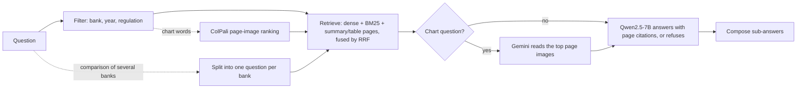

# Telaah

Indonesian document research agent. It answers questions over IDX bank annual reports and OJK/BI regulations, cites the page behind every claim, and refuses when the documents don't contain the answer. It runs locally on a 6 GB laptop GPU (Qwen2.5-7B through Ollama); the only cloud call is an optional Gemini free-tier vision call for chart pages.

**Status:** Phase 2 done (hybrid + visual retrieval, chart reading, cross-document questions). Phase 3 (agent + MCP tools) is next. Plan: `ROADMAP.md`.

## Results

50 hand-written seed questions with gold answers and gold pages (`eval/seed_questions.jsonl`): 15 table lookups, 12 text facts, 5 charts, 8 cross-document, 10 unanswerable. Same questions, same metrics, baseline vs. current:

| metric | baseline (dense RAG) | Telaah now |
|---|---|---|
| retrieval recall@5 (gold page in top 5) | 0.34 | **0.92** |
| numeric answers correct | 0.32 | **0.86** |
| LLM-judge correctness | 0.27 | **0.82** |
| refusal accuracy (refuse iff unanswerable) | 0.72 | **0.96** |
| faithfulness (claims supported by context) | 0.60 | **0.93** |
| citation accuracy (every cited page is a gold page) | 0.22 | **0.56** |
| latency per question | 138 s | **18 s** |

Current run by question type (`eval/runs/20261015-012031.json`):

| type | n | recall@5 | citation | refusal | numeric | judge |
|---|---|---|---|---|---|---|
| table_lookup | 15 | 1.00 | 0.67 | 1.00 | 0.87 | 0.93 |
| text_fact | 12 | 0.83 | 0.42 | 1.00 | 0.88 | 0.83 |
| chart | 5 | 1.00 | 0.80 | 0.80 | 0.80 | 1.00 |
| cross_doc | 8 | 0.75 | 0.00 | 0.88 | - | 0.43 |
| unanswerable | 10 | 1.00 | 0.90 | 1.00 | - | - |

Read the small groups with care: chart has 5 questions and cross_doc 8, so one question moves a score by 0.12-0.20, and the LLM judge sometimes scores identical answers differently. Regenerate any table with `python eval/summarize.py eval/runs/<run>.json [...]`.

### What moved the numbers

| step | recall@5 | numeric | what changed |
|---|---|---|---|
| baseline | 0.34 | 0.32 | BGE-M3 dense search only, Ollama defaults |
| fix Ollama context | 0.54 | 0.43 | Ollama silently cut prompts to ~2k tokens (dropping retrieved pages); set an 8k context, whole model on the GPU: 138 s -> 12 s per question |
| summary-page boost, per-bank quota | 0.72 | 0.57 | extra rankings over the front "financial highlights" pages; at most 3 pages per bank in comparison questions |
| compact tables, table-page signal | 0.86 | 0.75 | collapse table padding so the answer fits the per-page character cap; find multi-year tables |
| ColPali + Gemini chart reading | 0.92 | 0.89 | page-image retrieval for chart questions, retrieved pages transcribed by a vision model |
| cross-document split and compose | 0.92 | 0.86 | one sub-question per bank, then one compose call (numbers within noise; cross_doc judge 0.13 -> 0.43) |

Retrieval-only ablation (recall@5 on the 40 answerable questions, `eval/retrieval_eval.py`):

| pipeline | recall@5 |
|---|---|
| dense only | 0.17 |
| + bank/year/regulation filter | 0.30 |
| + BM25 (RRF fusion) | 0.42 |
| + summary and table-page rankings | 0.82 |
| + ColPali for chart questions | 0.90 |

A cross-encoder reranker (bge-reranker-v2-m3) did not help and is off by default. Rewriting tables so every value carries its year (`YEAR_ROWS=1`) lowered table accuracy from 0.87 to 0.67 with the 7B model and is off by default.

## How it works



- **Corpus:** 44 documents (annual reports of BCA, BRI, BNI, BTN, Mandiri; OJK and BI regulations), 13,784 pages, one chunk per page, parsed with Docling.
- **Retrieval:** BGE-M3 dense + own BM25, fused by reciprocal rank fusion; extra rankings limited to the front summary pages and to pages with a multi-year table. Questions are filtered to the banks, years and regulations they name.
- **Charts:** ColPali (`colqwen2-v1.0`) page-image index, built on a free Kaggle GPU, covers 3 reports (4,396 pages). For chart questions the top retrieved pages are rendered and transcribed by Gemini (`gemini-3.5-flash-lite`, free key); the transcript is put in front of that page's text.
- **Answering:** the prompt demands `[doc_id p.N]` after every claim and the exact reply `TIDAK DITEMUKAN` when the context has no answer. Output is capped (`MAX_ANSWER_TOKENS`) because the 7B can loop at temperature 0.
- **Cross-document:** the question is split into one simple question per bank or regulation, each runs the normal pipeline on its own documents, and a final call combines the sub-answers.

## Setup (Windows, PowerShell)

```powershell
python -m venv .venv
.venv\Scripts\Activate.ps1
pip install -e ".[dev]"            # add ,colpali for chart questions (colpali-engine, pymupdf)
copy .env.example .env
# install Ollama from https://ollama.com, then:
ollama pull qwen2.5:7b-instruct
ollama create qwen2.5:7b-gpu -f ollama/Modelfile    # 8k context, whole model on the GPU
```

Put the PDFs in `data/raw/` (not included), then:

```powershell
telaah ingest --no-en --workers 2   # Docling -> data/processed/*.jsonl (needs time and RAM)
telaah inventory                    # data/inventory.csv
telaah index                        # BGE-M3 -> embedded Qdrant (data/qdrant)
telaah ask "Berapa NPL gross BRI pada tahun 2025?"
$env:LLM_MODEL = "qwen2.5:7b-gpu"; telaah eval   # -> eval/runs/<timestamp>.json
pytest
```

- **Chart questions (optional):** build the ColPali index with `kaggle/colpali_index_stage1.ipynb` (steps in `KAGGLE_SETUP.md`), unzip it to `data/colpali/`, and set `GEMINI_API_KEY` in `.env`. Without them everything else still works.
- **Ollama:** the default context (4096 shared across 2 slots) truncates prompts. The Modelfile sets `num_ctx 8192` and `num_gpu 99`. Starting `ollama serve` with `OLLAMA_NUM_PARALLEL=1 OLLAMA_FLASH_ATTENTION=1 OLLAMA_KV_CACHE_TYPE=q8_0` also helps.
- **Memory (6 GB VRAM):** the 7B (5 GB) and ColQwen2 (4.4 GB) don't fit together, so ColQwen2 runs on the CPU during `ask`/`eval`. For retrieval-only ablations, `ollama stop qwen2.5:7b-gpu` and set `TELAAH_COLPALI_DEVICE=cuda`.
- **Retrieval-only ablation:** `python eval/retrieval_eval.py dense +filter +bm25 +summary +auto`.

## Metrics

- **recall@5:** a gold page is among the 5 retrieved pages (any gold page, not all).
- **citation accuracy:** the answer cites at least one page and every cited page is a gold page. It is strict: an answer that cites another page showing the same figure counts as wrong.
- **numeric:** all gold numbers appear in the answer (Indonesian number format handled).
- **correctness and faithfulness:** LLM judge (same local model).
- **refusal accuracy:** refuses exactly when the question is unanswerable.

## Limitations

- Only 50 questions, all written by the author and also used while developing the pipeline. There is no held-out test split yet, so the numbers are optimistic for unseen questions.
- The LLM judge is the same 7B model it grades and has not been checked against human grades.
- Cross-document questions are the weak spot (judge 0.43, citation 0.00, n=8). Open misses: q036-q038 (gold pages ranked too low), q040 (answer is in a regulation that the question doesn't name). q031 (a chart value without a unit) is refused on purpose.
- ColPali covers only the 3 reports with charts; other documents have text retrieval only.
- Chart reading depends on the Gemini free tier, whose rate limits and data terms can change.

## Next

Phase 3 of `ROADMAP.md`: tools as MCP servers (document search, page reader, calculator, citation checker), a planner-executor-verifier agent, and a larger benchmark with a held-out split.
