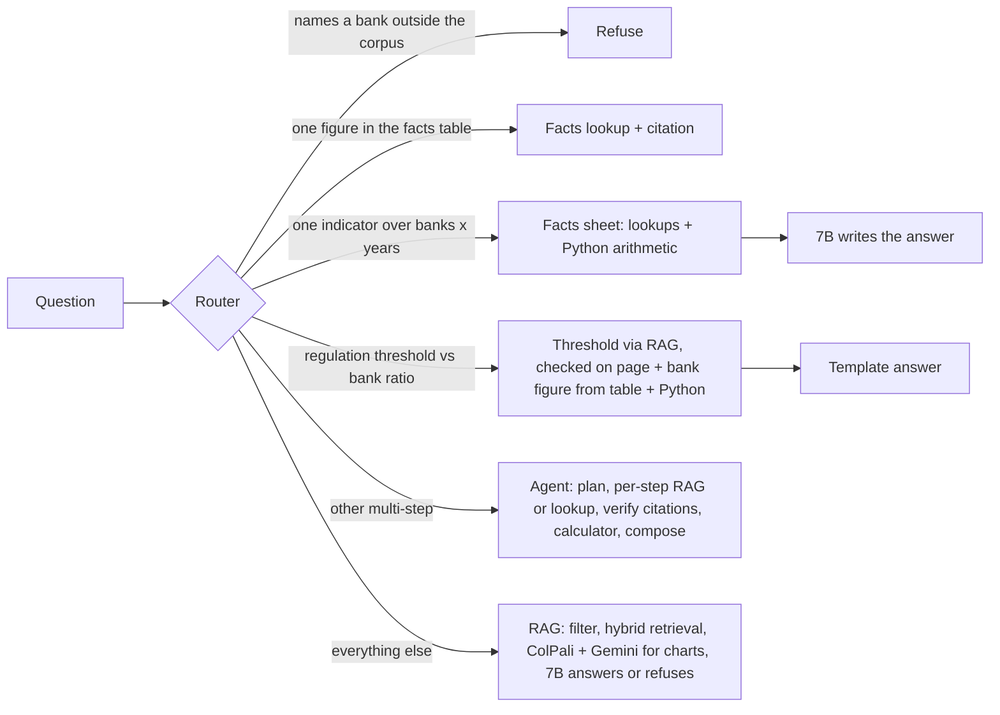

# Telaah

Indonesian document research agent. It answers questions over IDX bank annual reports and OJK/BI regulations, cites the page behind every claim, and refuses when the documents don't contain the answer. It runs locally on a 6 GB laptop GPU (Qwen2.5-7B through Ollama); the only cloud call is an optional Gemini free-tier vision call for chart pages.

**Status:** Phase 2 (hybrid + visual retrieval, chart reading, cross-document questions) and most of Phase 3 (agent, router, facts table, MCP tools, multi-step benchmark with a held-out set) are done. Plan: `ROADMAP.md`. Running log: `SESSION_NOTES.md`.

## Results

Two benchmarks, both scored automatically against gold answers and gold pages:

- **Seed questions** (`eval/seed_questions.jsonl`, 50): one-hop questions: 15 table lookups, 12 text facts, 5 charts, 8 cross-document, 10 unanswerable.
- **Agent tasks**: multi-step questions (rankings, trends, comparisons across banks, arithmetic, regulation thresholds vs bank figures, unanswerable). `eval/agent_tasks.jsonl` (60) is the development set; `eval/heldout_tasks.jsonl` (40) was frozen before any run on it (`eval/HELDOUT.md`). Every gold figure is parsed from its page by a builder script, and derived numbers are computed there.

### Agent tasks

A task counts as solved when every gold number is in the answer (unanswerable: when it refuses). All runs use the local 7B except the Gemini row.

| system | tasks | success | ranking | trend | multi-bank trend | compute | regulation | unanswerable | s/task |
|---|---|---|---|---|---|---|---|---|---|
| plain RAG, 7B | dev 60 | 0.38 | 0.33 | 0.50 | 0.00 | 0.21 | 0.63 | 1.00 | 20 |
| LLM-planned agent + router, 7B | dev 60 | 0.27 | 0.25 | 0.00 | 0.00 | 0.43 | 0.13 | 1.00 | 44 |
| same, Gemini 3.5 Flash-Lite | dev 60 | 0.73 | 0.58 | 0.80 | 0.80 | 0.64 | 0.75 | 1.00 | - |
| **Telaah now, 7B** | dev 60 | **0.95** | 1.00 | 1.00 | 1.00 | 0.86 | 0.88 | 1.00 | 12 |
| **Telaah, 7B, held-out** | held-out 40 | **0.93** | 1.00 | 1.00 | 1.00 | 0.90 | 0.83 | 0.83 | 11 |

The held-out number (37/40) was measured once, on commit `b61f6e4`, before two of its failures were fixed. Those fixes spent the set (see Limitations). The dev numbers are optimistic: every fix in this phase was developed on those 60 tasks.

The main lesson: with a 7B model, the agent design was never the bottleneck. A strong model got 0.73 through the same agent; the 7B failed at reading the right row of a table and at arithmetic. Moving both into code (facts table + Python) took the 7B from 0.38 to 0.95 and made it 2x faster.

Runs: `eval/runs/tasks-rag-20261015-093405.json`, `tasks-router-20261015-101830.json`, `tasks-router-20261015-101935-gemini.json`, `tasks-router-20261018-164809.json`, `tasks-heldout-router-20261018-163737.json`. Compare any of them with `python eval/run_agent_tasks.py --compare <runs...>`.

### Seed questions

Same 50 questions and metrics, from the first baseline to now (`eval/runs/20261018-171128.json`):

| metric | baseline (dense RAG) | Phase 2 (15 Oct) | **now** |
|---|---|---|---|
| retrieval recall@5 (gold page in top 5) | 0.34 | 0.92 | **0.94** |
| numeric answers correct | 0.32 | 0.86 | **0.86** |
| LLM-judge correctness | 0.27 | 0.82 | **0.92** |
| refusal accuracy (refuse iff unanswerable) | 0.72 | 0.96 | **0.92** |
| faithfulness (claims supported by context) | 0.60 | 0.93 | **0.91** |
| citation accuracy (every cited page is a gold page) | 0.22 | 0.56 | **0.70** |
| latency per question | 138 s | 18 s | **13.5 s** |

By question type (now):

| type | n | recall@5 | citation | refusal | numeric | judge |
|---|---|---|---|---|---|---|
| table_lookup | 15 | 1.00 | 0.80 | 0.93 | 0.93 | 1.00 |
| text_fact | 12 | 0.83 | 0.50 | 1.00 | 0.88 | 0.83 |
| chart | 5 | 1.00 | 0.60 | 0.60 | 0.60 | 1.00 |
| cross_doc | 8 | 0.88 | 0.75 | 0.88 | - | 0.86 |
| unanswerable | 10 | 1.00 | 0.80 | 1.00 | - | - |

Read the small groups with care: one chart question moves its scores by 0.20, and one cross_doc question by 0.12. The refusal and numeric dips since Phase 2 are one chart question (q030, plain RAG + Gemini vision) that is right in some runs and refused in others. Regenerate any table with `python eval/summarize.py eval/runs/<run>.json [...]`.

### What moved the numbers

Phase 2, seed questions:

| step | recall@5 | numeric | what changed |
|---|---|---|---|
| baseline | 0.34 | 0.32 | BGE-M3 dense search only, Ollama defaults |
| fix Ollama context | 0.54 | 0.43 | Ollama silently cut prompts to ~2k tokens (dropping retrieved pages); set an 8k context, whole model on the GPU: 138 s -> 12 s per question |
| summary-page boost, per-bank quota | 0.72 | 0.57 | extra rankings over the front "financial highlights" pages; at most 3 pages per bank in comparison questions |
| compact tables, table-page signal | 0.86 | 0.75 | collapse table padding so the answer fits the per-page character cap; find multi-year tables |
| ColPali + Gemini chart reading | 0.92 | 0.89 | page-image retrieval for chart questions, retrieved pages transcribed by a vision model |
| cross-document split and compose | 0.92 | 0.86 | one sub-question per bank, then one compose call |

Phase 3, agent tasks (dev 60, 7B):

| step | success | what changed |
|---|---|---|
| plain RAG | 0.38 | one retrieval + one answer |
| LLM-planned agent for all multi-step questions | 0.27 | planner -> per-step RAG -> citation verifier -> calculator -> compose; the 7B dropped banks from plans and misread tables |
| route single-bank trends and regulation questions back to RAG | ~0.38 (projected) | measured only on those 18 tasks: 0.07 -> 0.50 |
| **facts table** for one-figure steps | 0.50 on 10 tasks (was 0.10) | each "bank + indicator + year" step answered by lookup with a citation |
| **facts sheet**: plan and arithmetic in code | 0.90 | one indicator over banks x years: lookups are the plan, change/order/gap/mean/sum computed in Python, the 7B only writes |
| refuse scopes below the bank (district, branch) | 0.92 | t060 had answered a district-level question with the bank-wide figure |
| **regulation path** | 0.95 | threshold from RAG (checked as a percentage on the regulation page), bank figure from the table, comparison in Python |

Retrieval-only ablation (recall@5 on the 40 answerable seed questions, `eval/retrieval_eval.py`):

| pipeline | recall@5 |
|---|---|
| dense only | 0.17 |
| + bank/year/regulation filter | 0.30 |
| + BM25 (RRF fusion) | 0.42 |
| + summary and table-page rankings | 0.82 |
| + ColPali for chart questions | 0.90 |

A cross-encoder reranker (bge-reranker-v2-m3) did not help and is off by default. Rewriting tables so every value carries its year (`YEAR_ROWS=1`) lowered table accuracy from 0.87 to 0.67 with the 7B model and is off by default.

## How it works



- **Corpus:** 44 documents (annual reports 2024 and 2025 of BCA, BRI, BNI, BTN, Mandiri; OJK and BI regulations), 13,784 pages, one chunk per page, parsed with Docling.
- **Retrieval:** BGE-M3 dense + own BM25, fused by reciprocal rank fusion; extra rankings limited to the front summary pages and to pages with a multi-year table. Questions are filtered to the banks, years and regulations they name. Ratio abbreviations (NPL, CAR, KPMM, LDR, NIM, BOPO, CASA) are expanded for BM25.
- **Charts:** ColPali (`colqwen2-v1.0`) page-image index, built on a free Kaggle GPU, covers 3 reports (4,396 pages). For chart questions the top retrieved pages are rendered and transcribed by Gemini (`gemini-3.5-flash-lite`, free key); the transcript is put in front of that page's text.
- **Facts table** (`src/telaah/facts.py`, `data/facts.sqlite`): built at ingest time by code, without a per-page spec. Every markdown table of a bank report whose header row holds years is read row by row; rows whose label matches an indicator alias become facts (bank, report, page, indicator, year, value, unit). 821 facts, 14 indicators (NPL gross/net, CAR/KPMM, Tier 1, CET1, LDR, NIM, BOPO, CASA, ROA, ROE, total assets, profit, equity), 9 reports. Segment and subsidiary tables, coverage ratios and cash-flow rows are skipped. A lookup prefers the named report, then the report of that year; within a report the value printed on the most pages wins. DPK and total loans are left out on purpose: their rows are spread over segment and sub-total tables, so a lookup returned wrong figures.
- **Router** (`src/telaah/router.py`): rules, no extra LLM call. It refuses a question that names a bank outside the corpus, sends one-figure questions the table holds to a lookup, sheet questions and other multi-step questions to the agent, regulation-vs-bank questions to the regulation path, and the rest to RAG. Anything the table cannot answer (charts, quarters, attributable profit, industry figures, scopes below the bank) falls back to RAG.
- **Agent** (`src/telaah/agent.py`, LangGraph): plan -> execute -> verify -> compute -> compose -> verify. Each step is a lookup when the table holds it, else RAG; a step whose year the question does not ask about is corrected or left to RAG. Every cited sentence is checked against the cited page; a failing step is retried with more pages, then dropped.
- **Answering:** the prompt demands `[doc_id p.N]` after every claim and the exact reply `TIDAK DITEMUKAN` when the context has no answer. Output is capped (`MAX_ANSWER_TOKENS`) because the 7B can loop at temperature 0.
- **MCP server** (`src/telaah/mcp_server.py`): `list_documents`, `search_documents`, `read_page_text`, `read_page_image`, `calculate`.

## Setup (Windows, PowerShell)

```powershell
python -m venv .venv
.venv\Scripts\Activate.ps1
pip install -e ".[dev]"            # add ,colpali for chart questions (colpali-engine, pymupdf)
copy .env.example .env
# install Ollama from https://ollama.com, then:
ollama pull qwen2.5:7b-instruct
ollama create qwen2.5:7b-gpu -f ollama/Modelfile    # 8k context, whole model on the GPU
```

Put the PDFs in `data/raw/` (not included), then:

```powershell
telaah ingest --no-en --workers 2   # Docling -> data/processed/*.jsonl (needs time and RAM)
telaah inventory                    # data/inventory.csv
telaah index                        # BGE-M3 -> embedded Qdrant (data/qdrant)
python -m telaah.facts              # facts table -> data/facts.sqlite (seconds)
telaah ask "Berapa NPL gross BRI pada tahun 2025?"     # routed; --rag forces plain RAG
$env:LLM_MODEL = "qwen2.5:7b-gpu"
telaah eval --router                                  # seed questions -> eval/runs/<timestamp>.json
python eval/run_agent_tasks.py --mode router          # 60 dev agent tasks
python eval/check_facts.py                            # facts table vs the gold facts
pytest
```

- **Held-out tasks:** `python eval/run_agent_tasks.py --mode router --tasks heldout_tasks.jsonl`. Read `eval/HELDOUT.md` first: set #1 is spent.
- **Resumable runs:** each agent task is appended to a `.partial.jsonl`; after a crash or an API quota error, rerun with `--resume <that file>`.
- **Other LLMs:** any OpenAI-compatible endpoint via `LLM_BASE_URL`, `LLM_API_KEY`, `LLM_MODEL`; `LLM_MIN_INTERVAL` throttles requests (Gemini free tier: 15/min, 500/day).
- **Switches:** `TELAAH_FACTS=0` turns off the facts table everywhere (lookups, sheets, regulation path); `TELAAH_ALIASES=0` turns off the BM25 abbreviation expansion.
- **Chart questions (optional):** build the ColPali index with `kaggle/colpali_index_stage1.ipynb` (steps in `KAGGLE_SETUP.md`), unzip it to `data/colpali/`, and set `GEMINI_API_KEY` in `.env`. Without them everything else still works.
- **Ollama:** the default context (4096 shared across 2 slots) truncates prompts. The Modelfile sets `num_ctx 8192` and `num_gpu 99`. Starting `ollama serve` with `OLLAMA_NUM_PARALLEL=1 OLLAMA_FLASH_ATTENTION=1 OLLAMA_KV_CACHE_TYPE=q8_0` also helps.
- **Memory (6 GB VRAM, 16 GB RAM):** the 7B (5 GB) and ColQwen2 (4.4 GB) don't fit together, so ColQwen2 runs on the CPU during `ask`/`eval`. An eval process holds 4-7 GB of RAM (embedding model + reranker). Embedded Qdrant allows one process at a time: run evals one after another, never in parallel.

## Metrics

- **recall@5:** a gold page is among the 5 retrieved pages (any gold page, not all).
- **citation accuracy:** the answer cites at least one page and every cited page is a gold page. It is strict: an answer that cites another page showing the same figure counts as wrong.
- **numeric:** all gold numbers appear in the answer (Indonesian number format handled).
- **correctness and faithfulness:** LLM judge (same local model).
- **refusal accuracy:** refuses exactly when the question is unanswerable.
- **agent task success:** every gold number appears in the answer; unanswerable tasks must be refused. `partial` is the share of gold numbers found.

## Limitations

- **Small, self-written benchmarks.** 50 seed questions and 100 agent tasks, all written by the author (the held-out set by the same author, after seeing the dev failures). Real users will phrase questions in ways neither set covers.
- **Held-out set #1 is spent.** Its run found two gaps (a bank outside the corpus answered with the known bank's figure; a mean over years computed by the 7B), and both were fixed from that run. Its 0.93 stays the honest number for the code before those fixes; a new held-out set is needed before quoting another.
- **The facts-table aliases were written after reading these reports.** 102/102 gold values (`eval/check_facts.py`) shows the extractor is right on this corpus, not that it generalizes to other banks' table layouts.
- **The LLM judge** is the same 7B model it grades and has not been checked against human grades. On facts-table answers it sometimes marks a computed difference as unsupported.
- **Open misses:** t039 (the 7B rewrites a computed 4.249,99 as "4.25"; sheet answers are still written by the LLM), t046 (ratio of two indicators, e.g. profit / assets, is not computed in code), t053 (no threshold sentence found), q030 (chart reading via Gemini is unstable).
- **Coverage:** ColPali covers only the 3 reports with charts; the facts table covers only the 14 indicators above; restated prior-year figures differ between reports, so questions should name their source report.
- Chart reading depends on the Gemini free tier, whose rate limits and data terms can change.

## Next

1. Held-out set #2 (written before running; include questions that use the 2024 reports as their source).
2. Template the final answer for sheet questions (t039) and compute two-indicator ratios in code (t046).
3. Grow the benchmark (ROADMAP Phase 4) and a Gradio demo.
